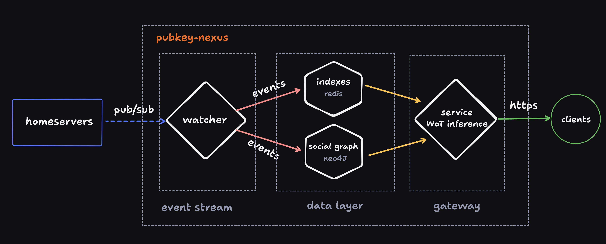
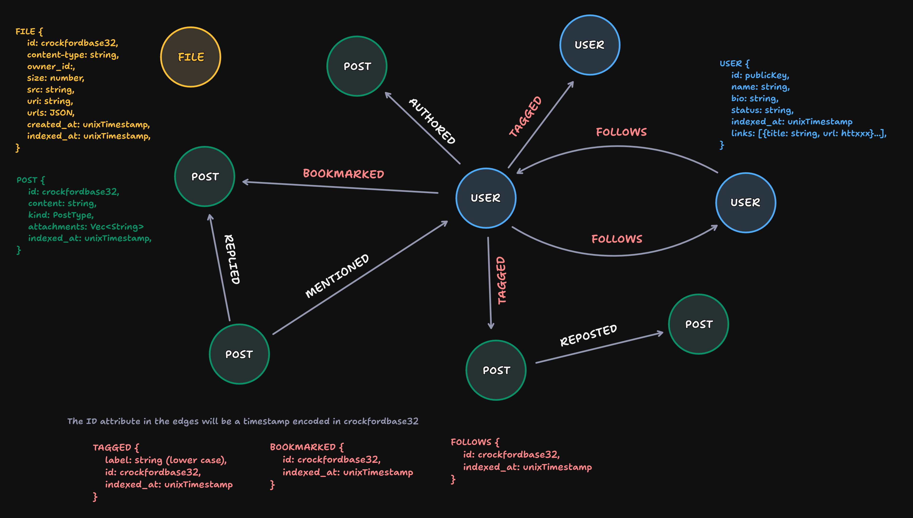

[](https://deepwiki.com/pubky/pubky-nexus)


# Pubky Nexus

Pubky Nexus is the central bridge connecting Pubky homeservers with [Pubky-App’s](https://github.com/pubky/pubky-app) social clients. By aggregating events from homeservers into a rich social graph, Nexus transforms decentralized interactions into a high-performance, fully featured social-media-like API. It's designed to support Social-Semantic-Graph (SSG) inference, and more.

## 🌟 Key Features

- **Real-time Social Graph Aggregation**: Nexus ingests events from multiple Pubky homeservers, generating a structured social graph in real time.
- **Full-Content Indexing**: Nexus serves content directly, improving latency and user experience. Clients do not need to locate homeservers to retrieve content unless they wish to perform content attestation. We also envision a light-weight Nexus mode that merely point clients to homeserver locations using pubky uris.
- **High Performance & Scalability**: Built in Rust, Nexus is optimized for speed and efficiency, handling complex social queries across distributed systems with minimal latency.
- **Powerful Social Semantic Graph**: Nexus supports SSG-based interactions, fostering secure and trusted connections between users.
- **Graph-Enhanced Search & Recommendations**: Nexus leverages Neo4j to offer deep insights, relationships, and recommendations based on the social graph.
- **Fast Indexes**: Redis holds sorted sets, search indexes and caches derived from the graph, which serve feeds, rankings and search without walking the graph on every request.
- **Rich Observability**: Easily explore the indexed data using [Redis Insight](https://redis.io/insight/) and visualize the graph database with [Neo4j Browser](https://browser.neo4j.io/).

## 🌐 Accessing the API

Nexus serves two versions of its REST API:

- **`/v1`** is the current API, read by the `social/v1` clients. Every new feature lands here.
- **`/v0`** is **deprecated and frozen**: fixes only, no new routes or fields. It serves the clients that have not moved to `/v1` yet and goes away once they all have. Its removal is announced in [CHANGELOG.md](CHANGELOG.md) at least one release ahead.

The OpenAPI documents are `/api-docs/v0/openapi.json`, `/api-docs/v1/openapi.json` and, for the `/static` file routes that go with `/v0`, `/api-docs/static/openapi.json`. The Swagger UI offers all three:

- **Staging API** (latest): [https://nexus.staging.pubky.app/swagger-ui/](https://nexus.staging.pubky.app/swagger-ui/)
- **Production API** (current): [https://nexus.pubky.app/swagger-ui/](https://nexus.pubky.app/swagger-ui/)

You can explore available endpoints, test queries, and view schema definitions directly within Swagger.

## 🏗️ Architecture Overview

Nexus is one binary, `nexusd`, built from four crates:

- **nexus-webapi**: the REST API, which answers client requests from Neo4j and Redis.
- **nexus-watcher**: reads the events of Pubky homeservers and turns them into graph and index updates.
- **nexus-common**: what the API and the watcher share: database connectors, models and queries.
- **nexusd**: runs the API, the watcher and the scheduled jobs, and holds the database commands: migrations, mock data, clearing.

### Data Flow



1. **Ingestion**: the watcher reads each homeserver's events and fetches the resources they name.
2. **Storage**: Neo4j holds the social graph, the source of truth. Redis holds the indexes and caches derived from it, plus the watcher's cursors and retry queue.
3. **Serving**: the API reads both to answer clients.



Nexus graph schema.

## 🚀 Quick Start

```bash
# Neo4j, Redis and Redis Insight
cd docker && cp .env-sample .env && docker compose up -d && cd ..

# The API, the watcher and the scheduled jobs, with ~/.pubky-nexus/config.toml
cargo run -p nexusd
```

The Swagger UI is then at [http://localhost:8080/swagger-ui](http://localhost:8080/swagger-ui). Mock data, the tests, the benchmarks and the database UIs are in the [development guide](docs/guides/development.md).

## 📚 Documentation

- [CHANGELOG.md](CHANGELOG.md): what changed in each version, and what to do when upgrading.
- Guides, in [docs/guides](docs/guides):
  - [Development](docs/guides/development.md): the local environment, the tests and the benchmarks.
  - [Homeservers](docs/guides/homeservers.md): how the watcher finds and indexes homeservers, and its config fields.
  - [Scheduled jobs](docs/guides/jobs.md): the jobs `nexusd` runs on a schedule or on demand.
  - [Data migrations](docs/guides/migrations.md): running them, and writing one.
  - [Observability](docs/guides/observability.md): OTLP telemetry, the local Grafana stack and the alerting rules.
  - [Versioning](docs/guides/versioning.md): what a version number promises, and the `/v1` contract.
  - [Releasing](docs/guides/releasing.md): how a release is cut.
- Decisions, in [docs/adr](docs/adr): why Nexus is built the way it is.

## 🤝 Contributing

1. **Fork the repository** and create a feature branch.
2. **Set up** the environment from the [development guide](docs/guides/development.md).
3. **Write tests**, and benchmarks where performance matters, for every change. Update the guide that covers what you changed.
4. **Open a pull request** that describes the change.
